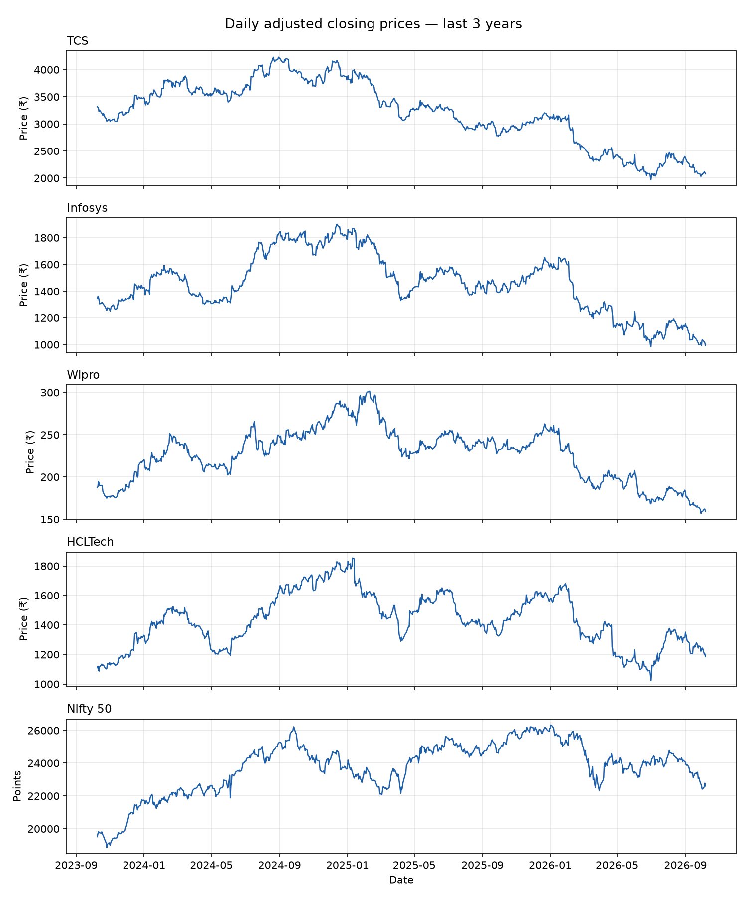
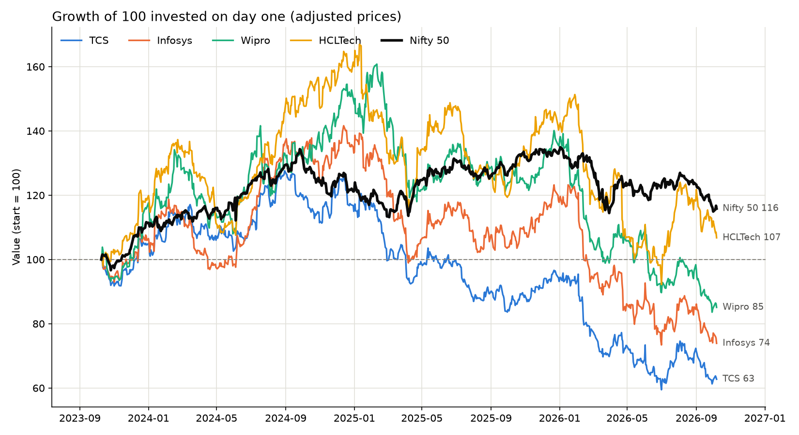

# Indian IT Stocks vs Nifty 50

An analysis of how four major Indian IT stocks (TCS, Infosys, Wipro, HCLTech) have performed against the Nifty 50 benchmark over the last 3 years.

## Tools used

- **Python**
- **yfinance**: downloads historical market data from Yahoo Finance
- **pandas**: cleans and analyses the data
- **matplotlib**: draws the charts
- **Jupyter**: notebooks for step-by-step analysis

## Setup

```bash
# 1. Create a virtual environment
python -m venv venv

# 2. Activate it
venv\Scripts\activate        # Windows
source venv/bin/activate     # macOS / Linux

# 3. Install the dependencies
pip install -r requirements.txt

# 4. Open the notebooks
jupyter notebook
```

## Project structure

```
01_data_collection.ipynb   Phase 1 notebook
02_returns.ipynb           Phase 2 notebook
data/                      Cleaned price data and results (CSV)
charts/                    Saved charts
requirements.txt           Exact package versions
```

## Phase 1: Data collection

Notebook: [`01_data_collection.ipynb`](01_data_collection.ipynb)

- Downloads daily **adjusted** closing prices for `TCS.NS`, `INFY.NS`, `WIPRO.NS`, `HCLTECH.NS` and the Nifty 50 (`^NSEI`) for a fixed window (9 Oct 2023 – 7 Oct 2026), so results are reproducible. Adjusted prices account for splits, bonus issues and dividends.
- Checks the data for gaps and fills missing values with **forward-fill** (the last known price), which avoids inventing prices or using future data.
- Removes 6 NSE holidays that Yahoo filled in with repeated prices. Left in, they would add fake 0% return days.
- Saves the cleaned data to `data/it_stocks_clean.csv` (739 trading days).
- Plots each price series over time and saves the result to `charts/price_history.png`.



## Phase 2: Returns and performance

Notebook: [`02_returns.ipynb`](02_returns.ipynb)

- Calculates **daily returns** (percentage change from one day to the next) and **cumulative returns** (compounded growth since day one).
- Plots all five series **rebased to 100** on one chart, so stocks and the index can be compared directly, with the Nifty 50 highlighted as the benchmark.
- Calculates **total return** and **annualised return (CAGR)** for each, and the gap versus the Nifty 50.
- Shows what **₹10,000** invested on day one would be worth today. This assumes dividends were reinvested and ignores costs and taxes.
- Saves the results to `data/performance_summary.csv`.

**Results (9 Oct 2023 – 7 Oct 2026):**

| | Total return | CAGR | vs Nifty (total) | ₹10,000 became |
|---|---:|---:|---:|---:|
| Nifty 50 | +15.8% | +5.0% | — | ₹11,584 |
| HCLTech | +6.7% | +2.2% | −9.1 pts | ₹10,675 |
| Wipro | −14.9% | −5.2% | −30.7 pts | ₹8,509 |
| Infosys | −26.1% | −9.6% | −41.9 pts | ₹7,390 |
| TCS | −37.3% | −14.4% | −53.1 pts | ₹6,273 |

All four IT stocks underperformed the Nifty 50. Only HCLTech made money, and TCS lost over a third of its value.

**Note:** The stock figures use adjusted prices (dividends reinvested), but the Nifty 50 (`^NSEI`) is a price-only index that excludes dividends. The benchmark's true return is therefore slightly higher than shown, so the IT stocks' underperformance is, if anything, understated.



## Phase 3: _Coming soon_

_TBD_

## Key findings

_To be added after the analysis phases._
